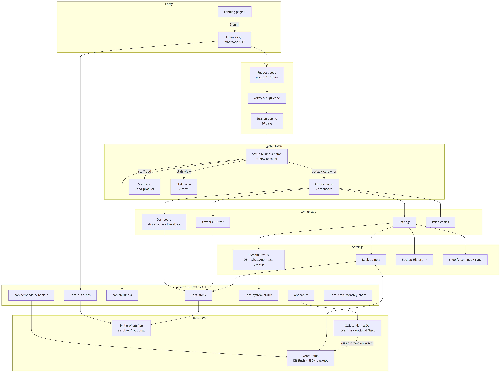

# StockPulse — Flow Diagram / Flowchart

**Purpose:** Core step-by-step picture of how the app is entered, authenticated, routed by role, used by owners, and connected to backend APIs and the data layer.  
**Shapes:** Oval = Start / End · Rectangle = Process · Diamond = Yes / No decision · Rounded = API or data service  

**Related documents:**  
1. Master Requirements Document  
2. PRD  
3. TRD  
4. Brand kit  
5. Schema  
6. Testing  

---

## Chart A — Full architecture flowchart (nothing skipped)

This is the complete application flow: Entry → Auth → Roles → Owner app → Settings → Backend APIs → Data layer (SQLite / libSQL, Vercel Blob, Twilio).

---

## Chart B — Same flow as a traditional process chart

Start oval through login decisions, role routing, owner settings, and the backend / data layer.

---

## Nodes included (checklist — do not skip)

### Entry
- Landing page `/`
- Login `/login` — WhatsApp OTP (Sign in)

### Auth
- Request code — max 3 / 10 min → `/api/auth/otp`
- Verify 6-digit code
- Session cookie — 30 days

### After login
- Setup business name if new account → `/api/business`
- Owner home `/dashboard` (equal / co-owner)
- Staff add `/add-product`
- Staff view `/items`

### Owner app
- Dashboard — stock value · low stock
- Owners & Staff
- Settings
- Price charts

### Settings
- System Status — DB · WhatsApp · last backup → `/api/system-status`
- Back up now
- Backup History →
- Shopify connect / sync

### Backend — Next.js API
- `app/api/*`
- `/api/stock`
- `/api/business`
- `/api/auth/otp`
- `/api/system-status`
- `/api/cron/daily-backup`
- `/api/cron/monthly-chart`

### Data layer
- SQLite via libSQL — local file · optional Turso
- Vercel Blob — DB flush + JSON backups (durable sync on Vercel)
- Twilio WhatsApp — sandbox / optional
